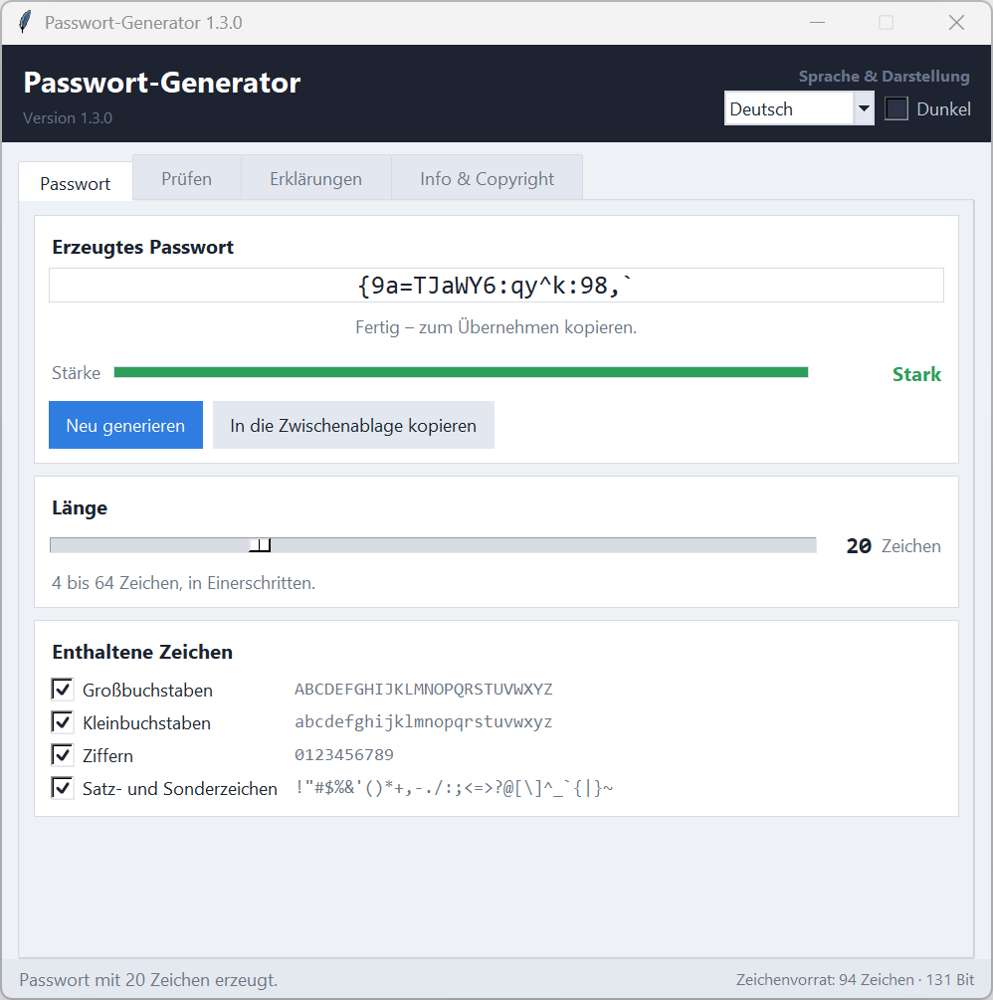
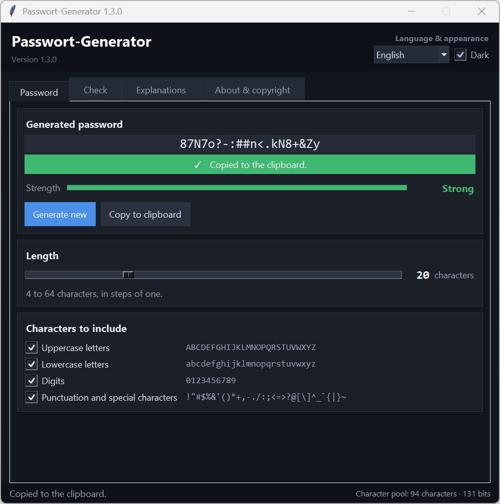

# Passwort-Generator

[](https://github.com/DerAlexmann/passwort-generator/actions/workflows/ci.yml)

Ein Passwortgenerator für Windows mit Schieberegler für die Länge, farbiger
Stärkeanzeige und einem Klick in die Zwischenablage. Die Oberfläche ist
deutsch und englisch, hell und dunkel, und merkt sich alle Einstellungen bis
zum nächsten Start.

*[English version: README.en.md](README.en.md)*



## Was er kann

- **Länge von 4 bis 64 Zeichen**, in Einerschritten am Schieberegler.
- **Stärkeanzeige** als farbiger Balken. Gemessen wird der Zufall im Passwort
  in Bit, also Länge und Zeichenvorrat zusammen: rot unter 55 Bit, gelb bis
  70 Bit, grün darüber. Mit allen vier Zeichengruppen heißt das rot bis 8
  Zeichen, gelb bei 9 und 10, grün ab 11 – aus Ziffern allein braucht es 22.
- **Eigenes Passwort prüfen** auf dem Reiter „Prüfen“: Eingabezeile, dieselbe
  Bit-Rechnung, Ergebnis beim Tippen. Den Zeichenvorrat schätzt das Programm
  aus den vorkommenden Zeichen. Gespeichert oder übertragen wird nichts.
- **Zeichenauswahl** per Haken – Großbuchstaben, Kleinbuchstaben, Ziffern,
  Satz- und Sonderzeichen. Jede angehakte Gruppe kommt mindestens einmal vor,
  solange die Länge dafür reicht; damit scheitert kein Passwort an einer
  Anmeldemaske, die eine Ziffer verlangt.
- **In die Zwischenablage kopieren**, mit grüner Bestätigung, die sich nach
  drei Sekunden von selbst zurücknimmt.
- **Deutsch und Englisch**, helles und dunkles Schema – beides umschaltbar,
  ohne dass sich das Fenster verändert.
- **Einstellungen bleiben erhalten**: Länge, Zeichenauswahl, Sprache, Schema
  und Fensterlage stehen in einer JSON-Datei neben dem Programm.



## Starten

**Als Programm:** `Passwort-Generator.exe` aus den
[Releases](../../releases) herunterladen und starten. Es wird nichts
installiert; die Einstellungsdatei entsteht beim ersten Schließen daneben.

> **Beim ersten Start**: Die EXE ist nicht signiert. Windows SmartScreen
> fragt deshalb einmalig nach – „Weitere Informationen" → „Trotzdem
> ausführen". Auch ein Virenschutz hält eine frisch heruntergeladene,
> unbekannte Datei gern für ein paar Sekunden fest, während er sie prüft; ein
> Startversuch in dieser Zeit kann mit „Zugriff verweigert" abbrechen.
> Einfach kurz warten und erneut starten. Wer sichergehen will, vergleicht
> vorher die SHA-256-Prüfsumme aus den Release-Notizen.

**Als Skript:** `Passwort-Generator.pyw` doppelklicken. Nötig ist nur Python
3.10 oder neuer mit Tkinter, das bei der Windows-Installation dabei ist.
Weitere Pakete braucht das Programm nicht.

```bash
python Passwort-Generator.pyw
```

## Tasten

| Taste | Wirkung |
|---|---|
| `F5` | neues Passwort erzeugen |
| `Strg`+`C` | Passwort in die Zwischenablage legen – auf dem Reiter „Prüfen“ nicht |

## Wie das Passwort entsteht

Gewürfelt wird mit dem Zufallsgenerator des Betriebssystems – dem
Python-Modul [`secrets`](https://docs.python.org/3/library/secrets.html), das
für Passwörter und Schlüssel gedacht ist. Aus jeder angehakten Gruppe kommt
zuerst ein Zeichen, der Rest wird aus dem gesamten Vorrat gezogen, und zum
Schluss wird die Reihenfolge mit `secrets.randbelow` gemischt.

Wie stark das Ergebnis ist, hängt an beidem: an der Länge und daran, aus wie
vielen Zeichen gewürfelt wurde. Die Stärkeanzeige rechnet daraus den Zufall
in Bit – Länge mal Logarithmus des Zeichenvorrats. Jedes Bit verdoppelt die
Zahl der Möglichkeiten; die Fußzeile zeigt beide Zahlen.

Der Reiter „Prüfen“ wendet dieselbe Rechnung auf ein eingegebenes Passwort
an. Dort ist der Zeichenvorrat nicht bekannt, sondern wird aus den
vorkommenden Zeichen geschätzt: eine Ziffer im Passwort heißt, dass alle
zehn Ziffern möglich waren, ein Umlaut zählt für sich allein. Die Zahl ist
damit eine Obergrenze und gilt nur für zufällig gewählte Passwörter – ein
Wort aus dem Wörterbuch mit angehängter Jahreszahl lässt sich erraten, ohne
alle Möglichkeiten durchzuprobieren.


Das erzeugte Passwort wird nirgends gespeichert; es verschwindet mit dem
Schließen des Fensters. In der Einstellungsdatei stehen nur Länge,
Zeichenauswahl, Sprache, Schema und Fensterlage.

## Eine Sprache ergänzen

Deutsch ist die Quellsprache: Der deutsche Text im Code ist zugleich der
Schlüssel. Am Ende von `Passwort-Generator.pyw` stehen `LANGUAGE_NAMES` und
`TRANSLATIONS`. Ein Kürzel in `LANGUAGE_NAMES`, ein Abschnitt in
`TRANSLATIONS` – fertig, die Auswahl oben rechts zeigt die Sprache sofort an.
Nicht übersetzte Zeilen erscheinen automatisch auf Deutsch.

## Selbst bauen

```bash
pip install pyinstaller
build.cmd
```

Das Ergebnis liegt anschließend in `dist\Passwort-Generator.exe`. Das
Programmsymbol lässt sich mit `python icon_erzeugen.py` neu erzeugen; dafür
wird Pillow gebraucht.

## Mitmachen

Fehlermeldungen, Vorschläge und Übersetzungen sind willkommen –
[CONTRIBUTING.md](CONTRIBUTING.md) erklärt Aufbau, Stil und Tests.
Sicherheitslücken bitte nicht als Issue, sondern über den Weg in
[SECURITY.md](SECURITY.md).

## Lizenz

[MIT](LICENSE) – Copyright 2026 Alexander Unverhau.
Erstellt mit Unterstützung von Claude AI.
